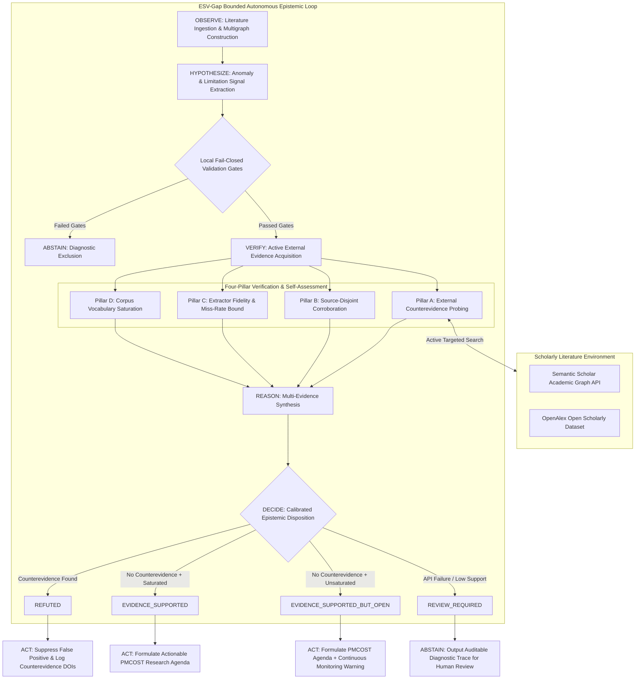

# ESV-Gap: Auditable Autonomous Scientific Reasoning Framework for Evidence-Grounded Hypothesis Triage

[](ESV-Gap/tests)
[](ESV-Gap/paper_v2/main_springer_ami.pdf)
[](ESV-Gap/src/autonomous_reasoning.py)

**ESV-Gap** is an auditable autonomous scientific reasoning system designed to bridge the gap between automated hypothesis generation and empirical verification under **bounded autonomy**. Rather than treating missing topological links or isolated entity clusters in an internal knowledge graph as unvetted research gaps, ESV-Gap embeds literature analysis within a closed-loop autonomous epistemic control cycle:

$$\text{\bf OBSERVE} \longrightarrow \text{\bf HYPOTHESIZE} \longrightarrow \text{\bf VERIFY} \longrightarrow \text{\bf REASON} \longrightarrow \text{\bf DECIDE} \longrightarrow \text{\bf ACT / ABSTAIN}$$

The system actively acquires external evidence from global scholarly indexes (Semantic Scholar, OpenAlex), enforces strict source-disjoint corroboration, empirically bounds extraction-induced false-negative risks, self-assesses corpus vocabulary saturation, and assigns calibrated epistemic dispositions before taking downstream action.

---

## Autonomous Epistemic Reasoning Architecture



---

## Core Epistemic Principles & Decision Semantics

### 1. Bounded Autonomy & Fail-Closed Safety
The system operates with **bounded autonomy**: it autonomously queries external scholarly repositories, parses counterevidence, computes graph metrics, applies deterministic verification policies, and synthesizes structured research questions. Critical boundaries (domain definitions, extraction ontologies, gold diagnostics) remain human-defined. Under any provider timeout, HTTP 429 quota exhaustion, or parsing failure, the engine defaults to **`REVIEW_REQUIRED` (Fail-Closed)**—retrieval failure is never conflated with evidence of absence.

### 2. Four-Pillar Verification and Self-Assessment
* **Pillar A (External Counterevidence Acquisition):** Targeted bi-directional queries probe Semantic Scholar and OpenAlex. A candidate is refuted if external peer-reviewed literature demonstrates existing solutions bridging the hypothesized gap.
* **Pillar B (Source-Disjoint Corroboration):** Requires that author-stated limitations originate from sources strictly disjoint from the candidate's origin publication ($\text{Sources}_{\text{candidate}} \cap \text{Sources}_{\text{corrob}} = \emptyset$).
* **Pillar C (Extractor Fidelity & False-Negative Bound):** Evaluated against a gold-standard diagnostic benchmark (10 papers, 36 triples; Recall = 77.8%, Precision = 87.5%, Miss Rate = 22.2%). The 95% Wilson interval of the miss rate is [11.7%, 38.1%]: roughly one gold relation in five is missed, so a missing edge alone cannot establish a scientific gap without external verification.
* **Pillar D (Corpus Coverage Self-Assessment):** Fits Heaps' law vocabulary growth ($E(n) = K \cdot n^\beta$) and marginal entity decay ($\Delta_{\text{decay}}$). In our primary run, $\beta = 0.995$ ($R^2 = 0.998$) and $\Delta_{\text{decay}} = -10.3\%$, classifying the corpus as **`UNSATURATED`** and preventing overconfident claims of global absence.

### 3. Epistemic Dispositions

| Disposition | Operational Meaning | Autonomous Downstream Action |
|---|---|---|
| **`REFUTED`** | Confirmed external counterevidence found in global literature. | Halt processing; suppress false positive; record counterevidence DOIs. |
| **`EVIDENCE_SUPPORTED`** | Zero counterevidence under protocol; $\ge 1$ independent corroborating source; corpus verified **`SATURATED`**. | Retain candidate; synthesize structured PMCOST research agenda. |
| **`EVIDENCE_SUPPORTED_BUT_OPEN`** | Zero counterevidence; independent corroboration verified; corpus is **`UNSATURATED`**. | Retain candidate; synthesize PMCOST agenda with epistemic open-world warning. |
| **`REVIEW_REQUIRED`** | Query failure, rate-limit, missing provenance, or zero corroboration. | Autonomous abstention; output diagnostic audit trace for human inspection. |

---

## Empirical Case Study: IoT Cybersecurity

Evaluated on frozen run `deep_learning_iot_intrusion_de_20260831_114802`:
* **Corpus:** 600 retrieved $\rightarrow$ 192 screened $\rightarrow$ 150 retained papers (2019--2026).
* **Multigraph:** 1,404 relation events connecting 1,185 canonical entities.
* **Candidate Triage Outcomes** (five post-gate candidates, as reported in the AMI 2027 paper, Table 3):
  1. *C1, Deep learning IoT IDS $\rightarrow$ Zero-day attacks:* **REFUTED** (2 verified counterevidence records, e.g., Nitrat et al. 2025).
  2. *C2, Deep learning IoT IDS $\rightarrow$ Standardized protocols:* **REVIEW_REQUIRED** (no counterevidence; the only local corroboration traces back to the candidate's own source paper, i.e., circular provenance).
  3. *C3, Deep learning IoT IDS $\rightarrow$ Industrial testbeds:* **REFUTED** (2 verified counterevidence records, e.g., Ogundokun et al. 2025).
  4. *C4, ML IoT IDS $\rightarrow$ Edge computational overhead:* **EVIDENCE_SUPPORTED_BUT_OPEN** (`SUPPORTED_OPEN` in the paper; 0 counterevidence, 3 source-disjoint 2026 corroborating papers, unsaturated corpus).
  5. *C5, ML IoT IDS $\rightarrow$ Adversarial attack defenses:* **REFUTED** (1 verified counterevidence record, Nguyen et al. 2025).

**False-positive suppression:** relying on graph sparsity alone would have promoted all five candidates. External verification refuted three (60%) and provenance checking escalated one to human review, so four of five (80%) were kept from premature promotion. These are descriptive statistics of a single case study ($n = 5$), not population estimates.

---

## Repository Structure

```text
research-paper-gap/
├── ESV-Gap/
│   ├── app.py                      # Interactive Streamlit Evidence Workbench
│   ├── config.yaml                 # Centralized pipeline and threshold configuration
│   ├── run_pipeline.py             # Stage runner (collect -> extract -> build -> detect -> validate -> score)
│   ├── src/
│   │   ├── autonomous_reasoning.py # Explicit Epistemic Loop, Dispositions & Decision Engine
│   │   ├── synthesize_rankings.py   # Multi-Pillar evidence synthesis & ranking
│   │   ├── validate_gaps.py        # Fail-closed local and external validation gates
│   │   ├── build_graph.py          # Temporal multigraph construction
│   │   ├── extract_triples.py      # Checkpointed relation extraction
│   │   ├── collect.py              # Semantic Scholar / OpenAlex API collectors
│   │   └── gap_provenance.py       # Graph-to-text source-disjoint tracing
│   ├── tests/                      # 129 offline unit and regression tests
│   ├── paper_v2/
│   │   ├── main_springer_ami.tex   # AMI 2027 manuscript (accepted, Springer LNCS/CCIS)
│   │   ├── canonical_results.json  # Numbers reported in the AMI paper (checked by tests/test_result_consistency.py)
│   │   ├── results_summary.json    # Frozen empirical results manifest
│   │   └── main_iot_run.tex, main_ieee.tex, main.tex   # Earlier drafts
│   ├── runs/                       # Experiment runs (local only, not in git)
│   ├── scratch/                    # One-off analyses, e.g. K_fetch sensitivity (eval_k_fetch.py)
│   ├── paper_ami2026/              # Separate draft: scope-aware decision control
│   ├── paper_icai2026/expanded_run/ # Multi-domain backtest data used by paper_ami2026
│   ├── gapclose/                   # ICAI-FAI 2026: certified gap claims (code, THEORY.md, README)
│   ├── paper_gapclose_icai2026/    # ICAI-FAI 2026 manuscript and supplementary material
│   └── iniscom/                    # EAI INISCOM 2027: GapCast-6G benchmark, forecaster, and LNICST manuscript
└── README.md                       # Repository documentation
```

---

## Installation & Verification

### Prerequisites
* Python 3.9+ (Python 3.10+ recommended)
* `pdflatex` (MiKTeX or TeXLive) for manuscript compilation

```powershell
# 1. Clone repository
git clone https://github.com/Khoa-Hoa-Technology-Solution-Company/research-paper-gap.git
cd research-paper-gap\ESV-Gap

# 2. Set up virtual environment
python -m venv .venv
.\.venv\Scripts\Activate.ps1
pip install -r requirements.txt
python -m spacy download en_core_web_sm

# 3. Run all 129 unit tests (offline, deterministic)
python -m unittest discover -s tests -v

# 4. Launch the Interactive Workbench
streamlit run app.py
```

### Re-running the synthesis stage on the frozen run
The frozen run `runs/deep_learning_iot_intrusion_de_20260831_114802` is kept locally and is not
in git (`runs/` is ignored). `synthesize_rankings.py` takes no command-line arguments; it reads
the `paths` block of a config. To re-run it on the frozen run, point the paths at the run
directory. Work on a copy, because the stage overwrites `outputs/final_rankings.json`:

```powershell
python -c "import yaml; from src.synthesize_rankings import synthesize_final_rankings as s; c=yaml.safe_load(open('config.yaml',encoding='utf-8')); r='runs/COPY_OF_FROZEN_RUN'; c['paths'].update(raw_data=r+'/data/raw', processed_data=r+'/data/processed', triples=r+'/data/triples', graph=r+'/data/graph', outputs=r+'/outputs', figures=r+'/outputs/figures'); print(s(c))"
```

This stage reproduces the run's stored `final_rankings.json` (4 refuted, 1 open). The AMI paper
reports the later two-stage verification (Stage A1 retrieval, Stage A2 semantic check), in which
C2 is not refuted but escalated for circular provenance. Those numbers are stored in
`paper_v2/canonical_results.json` and checked by `tests/test_result_consistency.py`; no script
in this repository regenerates that file yet.

### Compiling the AMI manuscript
```powershell
cd paper_v2
pdflatex main_springer_ami.tex
bibtex main_springer_ami
pdflatex main_springer_ami.tex
pdflatex main_springer_ami.tex
```

---

## Companion study: certified gap claims (ICAI-FAI 2026)

*Absence of Evidence Is Not a Research Gap: Certified Gap Claims under Corpus Incompleteness*
asks how often a gap finder calls a question open although the literature already answers it
(false novelty), and how to bound that error when the corpus is incomplete. It builds two
benchmarks from expert evidence labels (SciFact, Climate-FEVER), proves that conformal thresholds
calibrated in situ or with an upper bound on the missing rate keep false novelty below a target,
and validates the approach retrospectively against papers that answered the questions later.

* Code, data pipeline and reproduction steps: [`ESV-Gap/gapclose/README.md`](ESV-Gap/gapclose/README.md)
* Theory: [`ESV-Gap/gapclose/THEORY.md`](ESV-Gap/gapclose/THEORY.md)
* Manuscript: [`ESV-Gap/paper_gapclose_icai2026/`](ESV-Gap/paper_gapclose_icai2026/)
* Authors: Anh Hoa Le, Ly Van Khoa Phan, Dinh Thanh Nguyen, Duc Hoang Nguyen, Dinh Anh Ho, Long Truong (FPT University)

---

## Companion study: forecasting gap closure in 6G and IoT (EAI INISCOM 2027)

*Which Research Gaps Close? Forecasting Gap Closure in the 6G and IoT Literature* introduces
**GapCast-6G**, a temporal benchmark of 194,221 OpenAlex works (2010–2025) across 15 wireless and
IoT primary topics tagged with 90 concepts aligned with the six EAI INISCOM 2027 areas. Between 14%
and 25% of structural gaps close ($\ge 3$ joint-mention papers) within three years. Across four
publication-year-separated test cutoffs (2019–2022), a regularised logistic forecaster reaches mean
ROC AUC 0.809 against 0.659 for the Adamic–Adar index (concept-bootstrap intervals excluding zero
at three of four cutoffs; median mean AUC 0.797 across 20 fixed-seed 60-concept subsets), with
paper-level evidence traces and instance-level feature-to-logit error analysis at $T{=}2022$.

* Code, benchmark snapshot and reproduction steps: [`ESV-Gap/iniscom/README.md`](ESV-Gap/iniscom/README.md)
* Revision and verification report (Vietnamese): [`ESV-Gap/iniscom/REVISION_REPORT_VI.md`](ESV-Gap/iniscom/REVISION_REPORT_VI.md)
* Manuscript (Springer LNICST): [`ESV-Gap/iniscom/paper/main.tex`](ESV-Gap/iniscom/paper/main.tex) and [`ESV-Gap/iniscom/gapcast_iniscom2027_submission.pdf`](ESV-Gap/iniscom/gapcast_iniscom2027_submission.pdf)
* Authors: Anh Hoa Le, Long Truong (FPT University)

---

## Publication

* **Conference:** AMI 2027, International Conference on Autonomous Machine Intelligence (Vinh Long, Vietnam, April 22-24, 2027), proceedings in Springer CCIS. Accepted, paper #162.
* **Title:** *ESV-Gap: An Auditable Autonomous Reasoning Architecture for Evidence-Grounded Scientific Hypothesis Triage*
* **Authors:** Anh Hoa Le et al. (FPT University)
